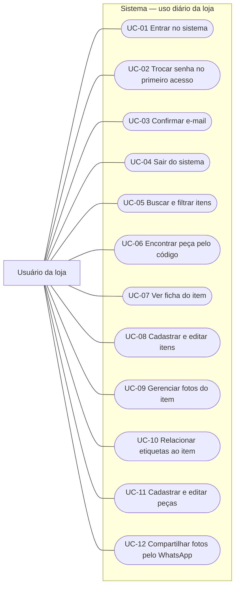
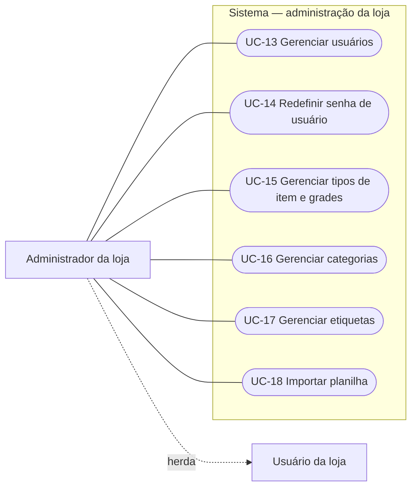
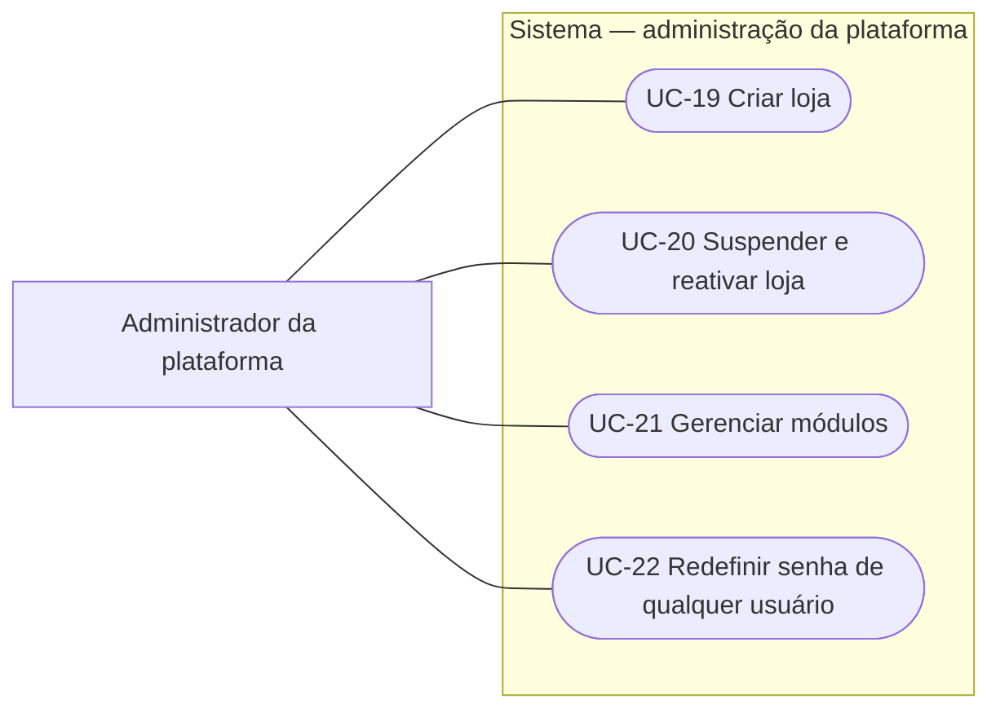

# Casos de uso

> Atualizado em 04/11/2026 · SaaS de gestão para lojas de aluguel de vestidos
> Versão do documento: 1.0.0

A v1 tem 22 casos de uso e três atores. Cada caso de uso aponta para os requisitos funcionais que cobre, em **requisitos-v1.md**.

## Sumário

1. [Atores](#1-atores)
2. [Diagrama](#2-diagrama)
3. [Descrição dos casos de uso](#3-descrição-dos-casos-de-uso)

---

## 1. Atores

| Ator | Quem é |
| --- | --- |
| Usuário da loja | Qualquer pessoa da loja com acesso ao sistema. Faz o trabalho do dia a dia no catálogo. |
| Administrador da loja | Usuário da loja cujo perfil permite gerenciar usuários e a configuração da loja. Faz tudo o que o usuário da loja faz, e mais. |
| Administrador da plataforma | O dono do SaaS. Cria e mantém as lojas; não pertence a nenhuma delas. |

O que cada perfil pode fazer exatamente será definido na matriz de permissões. Até lá, a divisão entre usuário e administrador da loja é uma proposta.

---

## 2. Diagrama

O diagrama está dividido em três partes, uma por ator, para ficar legível. A seta pontilhada "herda" indica que o administrador da loja também realiza todos os casos de uso do usuário da loja. O administrador da plataforma não pertence a nenhuma loja.

### Usuário da loja

### Administrador da loja

### Administrador da plataforma

---

## 3. Descrição dos casos de uso

### Usuário da loja

| UC | Caso de uso | O que acontece | Requisitos |
| --- | --- | --- | --- |
| UC-01 | Entrar no sistema | Informa e-mail e senha e acessa as telas liberadas para o seu perfil. | RF-01, RF-03 |
| UC-02 | Trocar senha no primeiro acesso | Ao entrar com uma senha provisória, define a própria senha antes de continuar. Ainda em decisão. | RF-08 |
| UC-03 | Confirmar e-mail | Abre o link recebido por e-mail para confirmar o endereço. | RF-09 |
| UC-04 | Sair do sistema | Encerra a sessão no aparelho. | RF-02 |
| UC-05 | Buscar e filtrar itens | Busca por texto e filtra por tipo, categoria, etiquetas, situação e tamanho. | RF-34, RF-35, RF-37 |
| UC-06 | Encontrar peça pelo código | Digita o código da etiqueta da peça e abre o item. | RF-36 |
| UC-07 | Ver ficha do item | Vê fotos, dados, etiquetas e as peças por tamanho e situação. | RF-31 |
| UC-08 | Cadastrar e editar itens | Cadastra, edita, desativa e reativa itens do catálogo. | RF-22, RF-23, RF-24 |
| UC-09 | Gerenciar fotos do item | Envia fotos, escolhe a capa e a ordem, e exclui fotos. | RF-25, RF-26 |
| UC-10 | Relacionar etiquetas ao item | Liga e desliga etiquetas cadastradas a um item. | RF-21 |
| UC-11 | Cadastrar e editar peças | Cadastra peças (uma ou várias de uma vez), edita, desativa e reativa. | RF-27 a RF-30 |
| UC-12 | Compartilhar fotos pelo WhatsApp | Envia as fotos de um item a uma cliente pelo celular. | RF-38 |

### Administrador da loja

| UC | Caso de uso | O que acontece | Requisitos |
| --- | --- | --- | --- |
| UC-13 | Gerenciar usuários | Cadastra usuários, altera nome e perfil, e desativa. | RF-04, RF-05, RF-07 |
| UC-14 | Redefinir senha de usuário | Define uma nova senha para um usuário que gerencia. | RF-06 |
| UC-15 | Gerenciar tipos de item e grades | Cadastra tipos de item e define a grade de tamanhos de cada um. | RF-16, RF-17, RF-18 |
| UC-16 | Gerenciar categorias | Cadastra, edita e desativa categorias. | RF-19 |
| UC-17 | Gerenciar etiquetas | Cadastra, edita e exclui etiquetas sem uso. | RF-20 |
| UC-18 | Importar planilha | Baixa o modelo, preenche e importa itens e peças de uma vez, após a validação. | RF-32, RF-33 |

### Administrador da plataforma

| UC | Caso de uso | O que acontece | Requisitos |
| --- | --- | --- | --- |
| UC-19 | Criar loja | Cria a loja com o primeiro administrador e o módulo catálogo ligado. | RF-10 |
| UC-20 | Suspender e reativar loja | Bloqueia ou libera o acesso de uma loja inteira. | RF-12 |
| UC-21 | Gerenciar módulos | Liga e desliga módulos por loja ou para todas, inclusive com desativação agendada. | RF-13, RF-14, RF-15 |
| UC-22 | Redefinir senha de qualquer usuário | Define uma nova senha para qualquer usuário, inclusive o administrador da loja. | RF-11 |
