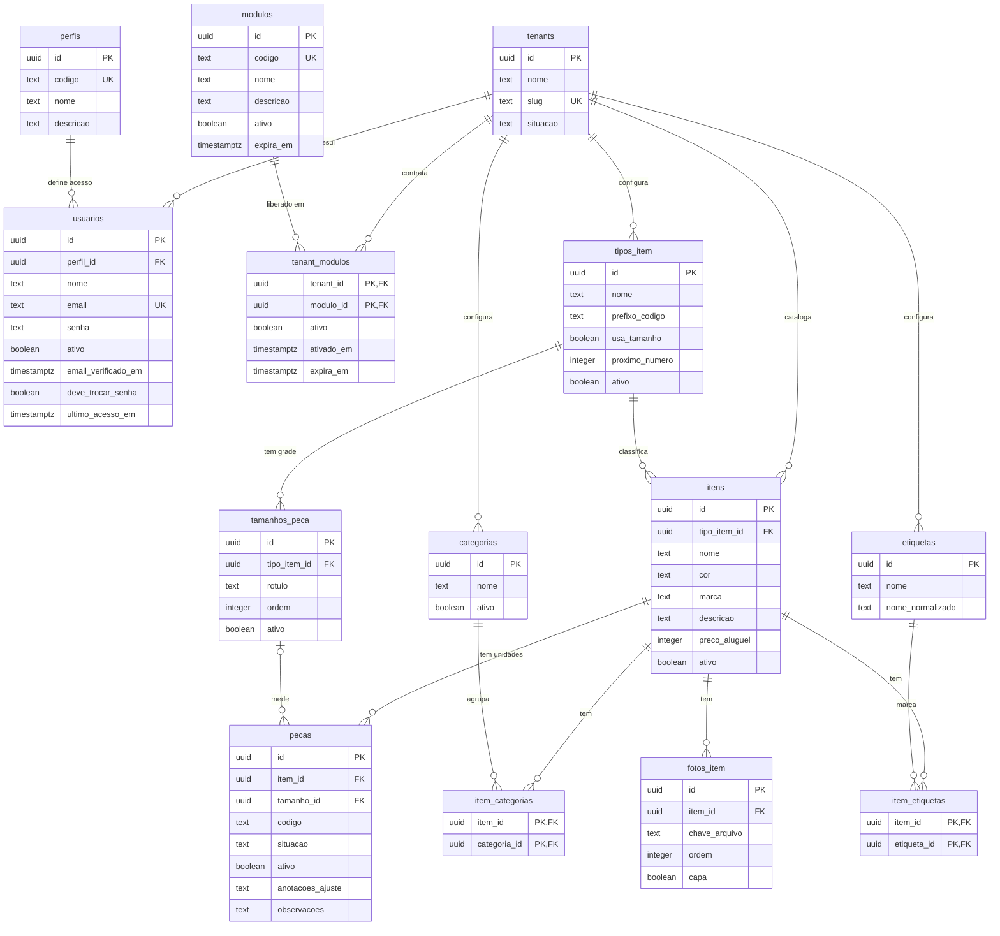

# Modelo de dados — (login e catálogo)

> Atualizado em 03/11/2026 · Banco: PostgreSQL (Neon)
> Versão do documento: 1.0.0

A v1 tem 14 tabelas, em três grupos:

- **Acesso:** `tenants`, `modulos`, `tenant_modulos`, `perfis`, `usuarios`
- **Configuração da loja:** `tipos_item`, `tamanhos_peca`, `categorias`, `etiquetas`
- **Catálogo:** `itens`, `item_categorias`, `item_etiquetas`, `fotos_item`, `pecas`

O **item** é o que a cliente escolhe no catálogo; a **peça** é a unidade física na arara. Exemplo: o item "Sereia Serenity" (tipo Vestido) tem as peças V-0001, tamanho 38, e V-0002, tamanho 42.

## Sumário

1. [Convenções](#1-convenções)
2. [Diagrama](#2-diagrama)
3. [Acesso](#3-acesso)
4. [Configuração da loja](#4-configuração-da-loja)
5. [Catálogo](#5-catálogo)
6. [Regras de negócio](#6-regras-de-negócio)
7. [Índices](#7-índices)
8. [Fora deste documento](#8-fora-deste-documento)

---

## 1. Convenções

- **Isolamento por loja:** toda tabela tem `tenant_id` → `tenants.id`, exceto `tenants`, `modulos` e `perfis`. O Postgres aplica Row-Level Security (RLS): cada consulta só enxerga as linhas da loja da sessão.
- **Referências na mesma loja:** as chaves estrangeiras entre tabelas da loja são compostas, `(tenant_id, x_id)` → `(tenant_id, id)`. Assim, o banco impede ligar a peça de uma loja ao item de outra.
- **Identificadores:** `id` em UUID v7, ordenável por data de criação.
- **Auditoria:** `criado_em` e `atualizado_em` em todas as tabelas; `atualizado_em` é mantido por trigger. `criado_por` → `usuarios.id` nas tabelas do catálogo.
- **Nomes:** português, sem acento, em snake_case.
- **Valores fixos:** colunas como `situacao` são `text` com `CHECK`, não enum do Postgres. Incluir um valor novo é uma migration simples.
- **Listas configuráveis:** tipos de item, tamanhos, categorias e etiquetas são dados de cada loja, não valores fixos no código.
- **Nada com histórico é apagado:** registros são desativados (`ativo = false`, loja `suspensa`).

---

## 2. Diagrama

Colunas comuns omitidas: `tenant_id` (exceto onde faz parte da chave), `criado_em`, `atualizado_em` e `criado_por`.

---

## 3. Acesso

### `tenants`

Cada loja cliente do SaaS.

| Campo | Tipo | Uso |
| --- | --- | --- |
| `id` | uuid | Identificador da loja. |
| `nome` | text | Nome da loja exibido no sistema. |
| `slug` | text, único | Identificador curto para URL, só com minúsculas, números e hífen (ex.: `loja-da-maria`). Reservado para um futuro subdomínio. |
| `situacao` | text | `ativa` ou `suspensa`. Loja suspensa não consegue entrar no sistema. |
| `criado_em`, `atualizado_em` | timestamptz | Auditoria. |

### `modulos`

Módulos que o SaaS oferece. Tabela global, sem `tenant_id`. As linhas são criadas por migration, no mesmo deploy que o código do módulo.

| Campo | Tipo | Uso |
| --- | --- | --- |
| `id` | uuid | Identificador do módulo. |
| `codigo` | text, único | Identificador fixo usado pelo código: `catalogo`, `reservas`, `financeiro`. Nunca muda. |
| `nome` | text | Nome exibido: "Catálogo", "Reservas". |
| `descricao` | text | O que o módulo faz. |
| `ativo` | boolean | Se for falso, o módulo fica desligado para todas as lojas. |
| `expira_em` | timestamptz, opcional | Desativação agendada para todas as lojas: a partir dessa data e hora, o módulo fica desligado. Vazio = sem agendamento. |
| `criado_em`, `atualizado_em` | timestamptz | Auditoria. |

### `tenant_modulos`

Módulos ligados em cada loja, uma linha por módulo. Chave: (`tenant_id`, `modulo_id`).

| Campo | Tipo | Uso |
| --- | --- | --- |
| `tenant_id` | uuid → `tenants.id` | Loja. |
| `modulo_id` | uuid → `modulos.id` | Módulo ligado. |
| `ativo` | boolean | Liga ou desliga o módulo para esta loja, sem apagar a linha. |
| `ativado_em` | timestamptz | Quando o módulo foi ligado. |
| `expira_em` | timestamptz, opcional | Desativação agendada para esta loja, como o fim de um teste grátis ou de um plano com prazo. Vazio = sem agendamento. |
| `criado_em`, `atualizado_em` | timestamptz | Auditoria. |

### `perfis`

Perfis de acesso dos usuários. Tabela global, sem `tenant_id`: os perfis são os mesmos em todas as lojas. As linhas são criadas por migration, porque as permissões de cada perfil ficam no código.

| Campo | Tipo | Uso |
| --- | --- | --- |
| `id` | uuid | Identificador do perfil. |
| `codigo` | text, único | Identificador fixo usado pelo código nas checagens de permissão: `dona`, `atendente`. Nunca muda. |
| `nome` | text | Nome exibido: "Dona", "Atendente". |
| `descricao` | text | O que o perfil pode fazer, em linguagem simples. |
| `criado_em`, `atualizado_em` | timestamptz | Auditoria. |

### `usuarios`

Pessoas que entram no sistema. Cada usuário pertence a uma única loja.

| Campo | Tipo | Uso |
| --- | --- | --- |
| `id` | uuid | Identificador do usuário. |
| `tenant_id` | uuid → `tenants.id` | Loja do usuário. |
| `perfil_id` | uuid → `perfis.id` | Perfil de acesso. Define o que a pessoa pode fazer no sistema. |
| `nome` | text | Nome exibido no sistema. |
| `email` | text, único | Login. Único no sistema todo, sem diferenciar maiúsculas, para o login identificar a loja pelo e-mail. |
| `senha` | text | Guarda a senha criptografada (hash), nunca a senha digitada. |
| `ativo` | boolean | Bloqueia o acesso de quem saiu da loja sem apagar o histórico. |
| `email_verificado_em` | timestamptz, opcional | Quando o e-mail foi confirmado. Vazio = não confirmado. |
| `deve_trocar_senha` | boolean | Pede a troca de senha no próximo login, quando a conta é criada com senha provisória. Padrão: falso. |
| `ultimo_acesso_em` | timestamptz, opcional | Data e hora do último login. |
| `criado_em`, `atualizado_em` | timestamptz | Auditoria. |

---

## 4. Configuração da loja

### `tipos_item`

As categorias de produto que a loja aluga (Vestido, Bolsa, Sapato, Brinco, Estola) e as regras que valem para todos os itens de cada uma. Único por (`tenant_id`, `nome`) e por (`tenant_id`, `prefixo_codigo`).

| Campo | Tipo | Uso |
| --- | --- | --- |
| `id` | uuid | Identificador do tipo. |
| `tenant_id` | uuid → `tenants.id` | Loja. |
| `nome` | text | Nome do tipo: Vestido, Bolsa, Sapato. |
| `prefixo_codigo` | text | Letra do código das peças desse tipo: V, B, S. Não muda depois da primeira peça. |
| `usa_tamanho` | boolean | Se as peças desse tipo têm tamanho. Ex.: vestido e bolsa sim; brinco não. Não muda depois da primeira peça. |
| `proximo_numero` | integer | Próximo número do código de peça. Começa em 1. Controlado pelo sistema, nunca editado à mão. |
| `ativo` | boolean | Tira o tipo das listas sem apagar. |
| `criado_em`, `atualizado_em` | timestamptz | Auditoria. |

### `tamanhos_peca`

A grade de tamanhos de cada tipo de item. Único por (`tipo_item_id`, `rotulo`) e por (`tipo_item_id`, `ordem`).

| Campo | Tipo | Uso |
| --- | --- | --- |
| `id` | uuid | Identificador do tamanho. |
| `tenant_id` | uuid → `tenants.id` | Loja. |
| `tipo_item_id` | uuid → `tipos_item.id` | Tipo a que a grade pertence. |
| `rotulo` | text | O que aparece na tela: "36", "40", "Único". É texto para aceitar P/M/G no futuro. |
| `ordem` | integer | Posição do tamanho na grade (36 = 1, 38 = 2…). Ordena as listas e permite buscar faixas, como "do 38 ao 44". Preenchida pelo sistema; o usuário não vê. |
| `ativo` | boolean | Tira o tamanho das opções sem afetar peças já cadastradas. |
| `criado_em`, `atualizado_em` | timestamptz | Auditoria. |

### `categorias`

Ocasiões de uso dos itens. Único por (`tenant_id`, `nome`).

| Campo | Tipo | Uso |
| --- | --- | --- |
| `id` | uuid | Identificador da categoria. |
| `tenant_id` | uuid → `tenants.id` | Loja. |
| `nome` | text | Madrinha, Debutante, Mãe dos noivos, Formatura. |
| `ativo` | boolean | Tira a categoria das listas sem afetar os itens. |
| `criado_em`, `atualizado_em` | timestamptz | Auditoria. |

### `etiquetas`

Marcadores livres para busca: comprimento, tecido, decote, família de cor. Único por (`tenant_id`, `nome_normalizado`).

| Campo | Tipo | Uso |
| --- | --- | --- |
| `id` | uuid | Identificador da etiqueta. |
| `tenant_id` | uuid → `tenants.id` | Loja. |
| `nome` | text | Como a etiqueta aparece: "Longo", "Renda", "Azul". |
| `nome_normalizado` | text | Nome em minúsculas e sem acento, gerado pelo sistema. Evita duplicatas como "Longo" e "longo" e acelera a busca. |
| `criado_em`, `atualizado_em` | timestamptz | Auditoria. |

---

## 5. Catálogo

### `itens`

O catálogo da loja. Preço, fotos, categorias e etiquetas ficam aqui, porque valem para todas as peças do item.

| Campo | Tipo | Uso |
| --- | --- | --- |
| `id` | uuid | Identificador do item. |
| `tenant_id` | uuid → `tenants.id` | Loja. |
| `tipo_item_id` | uuid → `tipos_item.id` | Tipo do item (um só). Define a grade de tamanhos e o prefixo do código das peças. Não muda depois da primeira peça. |
| `nome` | text | Nome pelo qual a loja conhece o item. |
| `cor` | text | Cor como a loja chama: "serenity", "marsala". Para buscar pela família ("azul"), use uma etiqueta. |
| `marca` | text, opcional | Marca ou estilista, a mesma da etiqueta costurada. |
| `descricao` | text, opcional | Detalhes livres sobre o item. |
| `preco_aluguel` | integer | Preço do aluguel em centavos (R$ 350,00 = 35000). Nunca negativo. |
| `ativo` | boolean | Tira o item do catálogo sem apagar o histórico. |
| `criado_por` | uuid → `usuarios.id` | Quem cadastrou. |
| `criado_em`, `atualizado_em` | timestamptz | Auditoria. |

### `item_categorias` e `item_etiquetas`

Tabelas de ligação: um item pode ter várias categorias (madrinha e formatura) e várias etiquetas. A chave é o par de colunas.

| Campo | Tipo | Uso |
| --- | --- | --- |
| `tenant_id` | uuid → `tenants.id` | Loja. |
| `item_id` | uuid → `itens.id` | Item ligado. |
| `categoria_id` ou `etiqueta_id` | uuid → `categorias.id` ou `etiquetas.id` | Categoria ou etiqueta ligada ao item. |
| `criado_em` | timestamptz | Quando a ligação foi feita. |

### `fotos_item`

Fotos do item. Ficam no item, não na peça, porque todas as peças de um item são iguais.

| Campo | Tipo | Uso |
| --- | --- | --- |
| `id` | uuid | Identificador da foto. |
| `tenant_id` | uuid → `tenants.id` | Loja. |
| `item_id` | uuid → `itens.id` | Item da foto. |
| `chave_arquivo` | text | Caminho do arquivo no Cloudflare R2 (`tenants/{tenant_id}/itens/{item_id}/{id}.webp`). O banco guarda só a chave, nunca a imagem. |
| `ordem` | integer | Ordem de exibição na galeria. |
| `capa` | boolean | Foto principal nas listas e no compartilhamento. No máximo uma por item. |
| `criado_por` | uuid → `usuarios.id` | Quem enviou a foto. |
| `criado_em`, `atualizado_em` | timestamptz | Auditoria. |

### `pecas`

A unidade física na arara. É o que será reservado na v2.

| Campo | Tipo | Uso |
| --- | --- | --- |
| `id` | uuid | Identificador da peça. |
| `tenant_id` | uuid → `tenants.id` | Loja. |
| `item_id` | uuid → `itens.id` | Item da peça. Preço, fotos e categorias vêm dele. |
| `tamanho_id` | uuid → `tamanhos_peca.id`, opcional | Tamanho da peça. Obrigatório quando o tipo do item usa tamanho; vazio quando não usa. |
| `codigo` | text | Código gerado pelo sistema (V-0001), único por loja. Vai numa etiqueta física para ligar a peça da arara ao cadastro. |
| `situacao` | text | `disponivel` (padrão) ou `indisponivel`. Na v2 ganha os estados das reservas. |
| `ativo` | boolean | Tira a peça de uso sem apagar o histórico. |
| `anotacoes_ajuste` | text, opcional | Ajustes feitos na peça e quanto ela ainda permite ajustar. |
| `observacoes` | text, opcional | Outras anotações: defeitos, consertos. |
| `criado_por` | uuid → `usuarios.id` | Quem cadastrou. |
| `criado_em`, `atualizado_em` | timestamptz | Auditoria. |

---

## 6. Regras de negócio

O banco garante as regras críticas; o que depende de mais de uma tabela fica no código, coberto por teste automatizado.

### Isolamento entre lojas

| Regra | Onde | Como |
| --- | --- | --- |
| Uma loja nunca vê dados de outra | Banco | RLS em toda tabela com `tenant_id`. A política compara a coluna com `app.tenant_id`, que o backend define no início de cada transação. |
| Referências só dentro da mesma loja | Banco | Chaves estrangeiras compostas `(tenant_id, x_id)` → `(tenant_id, id)`. Chave estrangeira não passa pelo RLS, então sem isso um bug poderia ligar dados de lojas diferentes. |
| `modulos` e `perfis` são globais e só de leitura | Banco | Fora do RLS. O usuário de banco da aplicação só tem permissão de leitura nessas tabelas. |

### Acesso e login

| Regra | Onde | Como |
| --- | --- | --- |
| O login encontra o usuário antes de saber a loja | Banco | A busca por e-mail roda numa função específica que ignora o RLS e devolve só o necessário para validar a senha. |
| E-mail único | Banco | Índice único em `lower(email)`. |
| Só entra quem está ativo, em loja ativa | Sistema | O login exige `usuarios.ativo = true` e `tenants.situacao = 'ativa'`. |
| Desativar um usuário encerra as sessões dele | Sistema | Ao desativar, as sessões abertas do usuário são apagadas. |
| Senha nunca guardada em texto | Sistema | A coluna `senha` recebe só o hash da senha, gerado pelo backend antes de gravar. |
| Toda loja tem ao menos uma dona ativa | Sistema | Não é possível desativar a última usuária com perfil `dona` nem mudar o perfil dela. |
| Senha protegida contra tentativa e erro | Sistema | Mínimo de 8 caracteres e limite de tentativas de login por e-mail e por IP. |
| Perfil sempre válido | Banco | `usuarios.perfil_id` é chave estrangeira para `perfis`. |
| Perfil e código nascem juntos | Processo | As linhas de `perfis` são criadas por migration, no mesmo deploy das permissões no código. O `codigo` nunca muda. |

### Módulos

| Regra | Onde | Como |
| --- | --- | --- |
| Módulo disponível só com quatro condições | Sistema | `modulos.ativo` e `tenant_modulos.ativo` verdadeiros, e o `expira_em` das duas tabelas vazio ou no futuro. Por isso a desativação agendada não precisa de tarefa programada. O backend verifica antes de responder qualquer rota do módulo; o frontend só esconde o menu. |
| O catálogo é o módulo base | Sistema | Toda loja nasce com `catalogo` ligado, e ele não pode ser desligado para uma loja. |
| Código e linha do módulo nascem juntos | Processo | A linha em `modulos` é criada por migration no mesmo deploy do código. O `codigo` nunca muda. |

### Catálogo

| Regra | Onde | Como |
| --- | --- | --- |
| Nomes únicos dentro da loja | Banco | Índices únicos com `tenant_id`: (`tenant_id`, `nome`) em `tipos_item` e `categorias`; (`tenant_id`, `nome_normalizado`) em `etiquetas`; (`tenant_id`, `prefixo_codigo`) em `tipos_item`. Duas lojas podem ter os mesmos nomes. |
| Código de peça único e nunca reaproveitado | Banco e sistema | Único em (`tenant_id`, `codigo`). O número vem de `tipos_item.proximo_numero`, incrementado na mesma transação que cria a peça. |
| Prefixo e uso de tamanho travados após a primeira peça | Sistema | `prefixo_codigo` e `usa_tamanho` não mudam se o tipo já tem peças. Mudar quebraria os códigos e os tamanhos existentes. |
| Tipo do item travado após a primeira peça | Sistema | `itens.tipo_item_id` não muda se o item já tem peças, porque elas usam a grade do tipo. |
| Tamanho segue a grade do tipo | Sistema | Obrigatório quando o tipo usa tamanho, proibido quando não usa, e sempre da grade do tipo do item. |
| Grade sem repetições | Banco | Único em (`tipo_item_id`, `rotulo`) e em (`tipo_item_id`, `ordem`). |
| No máximo uma foto de capa por item | Banco | Índice único parcial em `item_id` onde `capa = true`. |
| Sem etiquetas duplicadas por grafia | Sistema e banco | O sistema gera `nome_normalizado`, e o índice único usa essa coluna. |
| Preço válido e sem erro de arredondamento | Banco | `preco_aluguel` é inteiro em centavos, com `CHECK (preco_aluguel >= 0)`. A conversão para reais acontece só na tela. |
| Situação da peça só aceita valores conhecidos | Banco | `CHECK` com `disponivel` e `indisponivel`; padrão `disponivel`. |

### Exclusão e histórico

| Regra | Onde | Como |
| --- | --- | --- |
| Registros com histórico são desativados, não apagados | Sistema | Lojas são suspensas; usuários, tipos, tamanhos, categorias, itens e peças recebem `ativo = false`. |
| O banco recusa apagar algo referenciado | Banco | As chaves estrangeiras usam `RESTRICT`. |
| Exclusão física só onde não há histórico | Sistema | Podem ser apagadas: fotos (o arquivo no R2 é removido junto), ligações em `item_categorias` e `item_etiquetas`, e etiquetas sem uso. |

### Criação de uma loja

| Regra | Onde | Como |
| --- | --- | --- |
| A loja nova já nasce pronta para uso | Sistema | Numa única transação: cria o tenant, o primeiro usuário administrador e liga o módulo `catalogo`. Tipos de item, grades e categorias são cadastrados depois pela própria loja. |

---

## 7. Índices

| Tabela | Índice | Para quê |
| --- | --- | --- |
| Tabelas referenciadas por outras | Único em (`tenant_id`, `id`) | Permite as chaves estrangeiras compostas. |
| `usuarios` | Único em `lower(email)`; (`tenant_id`, `perfil_id`) | Login e checagem da última dona ativa. |
| `itens` | (`tenant_id`, `tipo_item_id`); trigrama (`pg_trgm`) em `nome` e `cor` | Filtro por tipo e busca por texto parcial, sem acento. |
| `pecas` | Único em (`tenant_id`, `codigo`); (`tenant_id`, `item_id`); (`tenant_id`, `tamanho_id`) | Busca por código e por tamanho. |
| `item_categorias` | (`tenant_id`, `categoria_id`) | Filtro por categoria. |
| `item_etiquetas` | (`tenant_id`, `etiqueta_id`) | Filtro por etiqueta. |
| `fotos_item` | Único parcial em `item_id` onde `capa = true` | Uma capa por item. |

---

## 8. Fora deste documento

- **Matriz de permissões por perfil:** o que os perfis `dona` e `atendente` podem fazer em cada módulo. É a próxima etapa.
- **Tabelas da biblioteca de autenticação:** sessões e pedidos de redefinição de senha.
- **v2 — Reservas:** `clientes`, `reservas` e `reserva_pecas`, com bloqueio de conflito de datas. `pecas.situacao` ganha estados como prova, alugada e lavanderia.
- **v3 — Financeiro:** pagamentos, sinal, caução e multas ligados à reserva.
